<picture>
  <source media="(prefers-color-scheme: dark)" srcset="docs/assets/header-dark.svg">
  
</picture>

<div align="center">

[](https://github.com/raven-clown/rosetta/actions/workflows/ci.yml)
[](https://github.com/raven-clown/rosetta/releases)
[](https://pkg.go.dev/github.com/raven-clown/rosetta)
[](LICENSE)
[](https://scorecard.dev/viewer/?uri=github.com/raven-clown/rosetta)
[](https://goreportcard.com/report/github.com/raven-clown/rosetta)

</div>

Write an agent once in Go. Serve it over MCP, A2A, ACP and AG-UI at the same time.

> **Status: early, [v0.1.0](https://github.com/raven-clown/rosetta/releases/tag/v0.1.0).** Milestones 1 and 2 are done: the four protocol adapters, the `llm`, `a2a` and `echo` agent kinds, a config file, API keys, `/readyz` and metrics. Storage and the admin API come next, and the Go API may still change before v1. Watch the repository or pick an issue if you want to help shape it.

## How it works

<picture>
  <source media="(prefers-color-scheme: dark)" srcset="docs/assets/how-it-works-dark.svg">
  
</picture>

## Install

With Go 1.26 or later:

```bash
go install github.com/raven-clown/rosetta/cmd/rosetta@latest   # the rosetta command
go get github.com/raven-clown/rosetta@latest                  # the library, for agents written in Go
```

Prebuilt binaries for Linux, macOS and Windows are planned.

## Try it

The protocol layer works today, with a built-in echo agent:

```bash
go run github.com/raven-clown/rosetta/cmd/rosetta@latest serve
```

```bash
curl -N -X POST localhost:8080/agui/echo -H 'Content-Type: application/json' \
  -d '{"threadId":"t1","runId":"r1","messages":[{"id":"u1","role":"user","content":"hello"}],"tools":[],"context":[],"state":null}'
```

The same agent answers MCP on `localhost:8080/mcp`, has an A2A card at `localhost:8080/.well-known/agent-card.json`, and talks ACP to an editor with `rosetta stdio --protocol acp`. Without a config file, auth is off, so keep it on localhost.

For real agents, write a config like [examples/rosetta.yaml](examples/rosetta.yaml) and start it with:

```bash
ROSETTA_LOCAL_KEY=dev-key rosetta serve --config examples/rosetta.yaml
```

Callers then send `Authorization: Bearer dev-key`. `/readyz` checks that transponder and airlock answer, and `/metrics` serves Prometheus metrics.

## Why

Each agent protocol reaches a different set of clients:

| Protocol | Who talks it |
|---|---|
| [MCP](https://modelcontextprotocol.io) | Claude Desktop, Cursor and other MCP clients, plus other agents |
| [A2A](https://a2a-protocol.org) | other agents and orchestrators |
| [ACP](https://agentclientprotocol.com) | editors such as Zed and JetBrains IDEs |
| [AG-UI](https://docs.ag-ui.com) | web front ends such as CopilotKit |

Supporting all four today means four servers, four event models and four ways of handling sessions, cancellation and auth. rosetta gives you one small interface and does the translation:

```go
agent := rosetta.Func(rosetta.Card{Name: "echo"},
	func(ctx context.Context, req *rosetta.Request, out rosetta.Stream) error {
		return out.Text("you said: " + req.Input[0].Text)
	})

srv := server.New(server.Options{}, agent)
http.ListenAndServe(":8080", srv.Handler())
```

That one value answers on `/mcp`, `/a2a/echo` and `/agui/echo`, and `rosetta stdio --protocol acp` serves it to an editor.

You don't need to write Go at all. Declare an agent in YAML or through the admin API:

```yaml
agents:
  - name: helper
    kind: llm
    model: claude-sonnet-5-5
    system_prompt: You are a helpful assistant.
    tools: ["github__*"]
```

Or wrap an existing A2A agent, so it shows up in Zed, Claude Desktop and your web app without any code:

```yaml
agents:
  - name: travel
    kind: a2a
    url: https://agents.example.com/travel
```

## How it compares

**Agent frameworks** such as [adk-go](https://github.com/google/adk-go), [eino](https://github.com/cloudwego/eino) and [trpc-agent-go](https://github.com/trpc-group/trpc-agent-go) own the agent loop: models, tools, workflows, memory. rosetta doesn't. It owns the edge, so your agent can be a hand-written loop, a framework agent or a remote service. The two fit together: a small bridge turns a framework agent into a `rosetta.Agent`.

**Hosted agent platforms** serve some of these protocols too, but keep parts of it behind a paid plan. rosetta has **no paid edition and no license key**. Roles, audit logs, SSO, Postgres clustering and the admin API all ship in the Apache-2.0 build. See the comparison, with links to each vendor's pricing page, in [the design](docs/design.md#everything-is-free).

## What v0.1.0 has

- One Go interface, `rosetta.Agent`, and four protocol adapters (MCP over Streamable HTTP and stdio, A2A over JSON-RPC and REST, ACP over stdio, AG-UI over SSE)
- Built-in agent kinds: `llm` (a tool-calling loop over any OpenAI-compatible API), `a2a` (a remote A2A agent) and `echo`
- Tools through any MCP server, models through any OpenAI-compatible endpoint
- A YAML config with `${VAR}` expansion and `ROSETTA_*` overrides
- API keys with `admin`, `member` and `viewer` roles, `/healthz`, `/readyz`, Prometheus `/metrics`, JSON logs

Still to come before v1: SQLite and Postgres storage, and a JSON admin API under `/admin/v1/` with an OpenAPI file, ready for a web console.

## Roadmap

| Milestone | What |
|---|---|
| 1, in v0.1.0 | Core types, runner, the four adapters, echo agent, `rosetta serve` and `rosetta stdio` |
| 2, in v0.1.0 | `llm` and `a2a` agent kinds, config file, API keys, health and metrics |
| 3 | SQLite and Postgres storage, sessions, run history |
| 4 | Admin API, first-run admin key, audit log, usage |
| next | OIDC sign-in, OpenTelemetry traces, input-required flows, files and images, framework bridges |

## Part of mothership

rosetta is one of four projects that work alone and fit together, following a [shared contract](https://github.com/raven-clown/mothership/blob/main/CONTRACT.md):

- [airlock](https://github.com/raven-clown/airlock), an MCP gateway. rosetta agents call tools through it.
- [transponder](https://github.com/raven-clown/transponder), an LLM gateway. rosetta agents call models through it.
- [logbook](https://github.com/raven-clown/logbook), shared agent memory served over MCP.

None of them is required. Each link is a URL in the config.

## Help build it

The easiest way in is a protocol adapter: each protocol lives in its own package under `protocol/`, with golden tests that show exactly what goes over the wire. Issues labelled [`good first issue`](https://github.com/raven-clown/rosetta/labels/good%20first%20issue) say which files to change and which tests to add. Read [CONTRIBUTING.md](CONTRIBUTING.md) first.

- Found a bug, or want something new? Open an issue with one of the [issue forms](https://github.com/raven-clown/rosetta/issues/new/choose). Each one says what to include.
- Pull requests come with a template that lists what reviewers check first in this project, so you know what to cover before you open one.

## Contributors

Thanks to everyone who has helped build rosetta.

<a href="https://github.com/raven-clown/rosetta/graphs/contributors"></a>

## License

[Apache-2.0](LICENSE)
